# The Vuln Engine — a deep dive for the new engineer

> **Audience:** an engineer onboarding to `service/vuln_engine/` who has never
> seen the codebase. **Assumption:** you can read Python, you know roughly what
> an XSS and a SQL injection are. Everything else is taught here.
>
> **How to use it:** read front to back once (≈45 min), then do the lab in §20
> with the code open. This document teaches; the
> [`VULN_ENGINE_MASTER_REFERENCE.md`](./VULN_ENGINE_MASTER_REFERENCE.md)
> *records* — every constant, module and decision, with its reasoning in §23
> there. When you want "what exactly does X cost? is Y a finding?",
> look it up in the master reference; when you want to *understand* the engine,
> read this.
>
> Written against the code on branch `attackbot/feature/vuln-engine`
> (2026-10-20). Tests at this revision: `pytest tests/vuln_engine tests/ui` hermetic
> 1009 passed / 17 skipped, `mypy` clean (152 source files).

---

## Table of contents

1. [Where you are](#1-where-you-are)
2. [The one-sentence thesis](#2-the-one-sentence-thesis)
3. [The five invariants](#3-the-five-invariants)
4. [The mental model — ask, measure, verify, record, derive](#4-the-mental-model--ask-measure-verify-record-derive)
5. [The vocabulary (kernel/)](#5-the-vocabulary-kernel)
6. [The life of an arm — the heartbeat](#6-the-life-of-an-arm--the-heartbeat)
7. [Inside the PolicyGate](#7-inside-the-policygate)
8. [Observations — bytes in, typed facts out](#8-observations--bytes-in-typed-facts-out)
9. [Verification — the ensemble](#9-verification--the-ensemble)
10. [Techniques — the corpus](#10-techniques--the-corpus)
11. [Scheduling — spending visibility well](#11-scheduling--spending-visibility-well)
12. [The world log — the only truth, and the census view](#12-the-world-log--the-only-truth-and-the-census-view)
13. [Capability Closure — measuring preconditions](#13-capability-closure--measuring-preconditions)
14. [The two-gate flow](#14-the-two-gate-flow)
15. [The LLM advisory](#15-the-llm-advisory)
16. [The abductive loop](#16-the-abductive-loop)
17. [Memory](#17-memory)
18. [The graph→seed bridge](#18-the-graphseed-bridge)
19. [The UI](#19-the-ui)
20. [The lab — run it yourself](#20-the-lab--run-it-yourself)
21. [Contributing — the three checklists](#21-contributing--the-three-checklists)
22. [Where to next](#22-where-to-next)

---

## 1. Where you are

Attackbot has two halves, and the vuln engine is the second one.

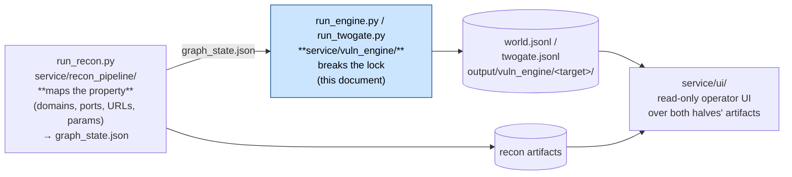

The recon half is deliberately *passive*: it finds subdomains, ports, URLs and
their parameters on someone else's site, but it does not send attack traffic.
The engine half reads that map — or an operator's hand-declared list of inputs —
and *attacks*: it subscribes each candidate input to small, focused programs
("techniques") that propose hypotheses, runs probes, and proves or refuses each
result. A third program, `service/ui/`, is a read-only web view over the files
both halves write.

Everything the engine does is authorized, measured, recorded, and *replayable
offline*. Hold on to those four words; by the end of §3 they will be obvious.

### The players, named once, used everywhere

| Player | File | What it is |
|---|---|---|
| **Surface** | `kernel/technique.py` | one input worth testing: a URL, a parameter, a position (`where`), and a **capability claim** |
| **Technique** | `techniques/<name>/` | a small program for one vulnerability class — four pure functions and a manifest |
| **Hypothesis** | `kernel/technique.py` | one testable claim on one surface ("param `id` is reflected in the response") |
| **ProbeSpec** | `kernel/technique.py` | one measurement to attempt: URL, payload, oracle, noise, purpose |
| **PolicyGate** | `policy/gate.py` | *the only door to the network* — authorizes every single request |
| **Observation** | `kernel/observation.py` | a typed fact parsed from a raw response (never a string blob) |
| **Candidate** | `kernel/verdict.py` | "I believe this is a finding", carrying its proposer's evidence grade and a **confirmation spec** for someone else to re-measure |
| **Verifier** | `verification/*` | an independent re-measurement in a different evidence class |
| **Verdict** | `kernel/verdict.py` | proven or refused — the referee's word |
| **WorldLog** | `world/log.py` | the append-only JSONL ledger; the *only* place truth lives |

---

## 2. The one-sentence thesis

> **One finding, independently verified, replayable, gate-audited — with zero
> LLM code in the path that decides.**

This is deliberately narrow and testable, and it is what every design choice
below defends. The engine can run with *no model key at all* and behave
byte-for-byte deterministically. Everything else — UCB scheduling, the attack
tree, the LLM junctions, the abductive loop, the two-gate flow — is additive,
and none of it weakens the claim.

Why so rigid? Because the engine's job is reporting *vulnerabilities in someone
else's system* to a human who will act on the report — notify a bounty program,
annotate a customer. A scanner that cries wolf is worse than none. The entire
architecture is the mechanical enforcement of one epistemic rule:

> **Generated is a lead; executed-and-observed is a finding.**

A candidate becomes a finding *only* through a verifier using a **different
evidence class**. The technique that proposed it never confirms it. This is
Invariant 2, and it is the load-bearing wall of the whole building.

---

## 3. The five invariants

These are the design. Everything else is implementation. Each is enforced
structurally — by a type, an import graph, or a test — not by convention.

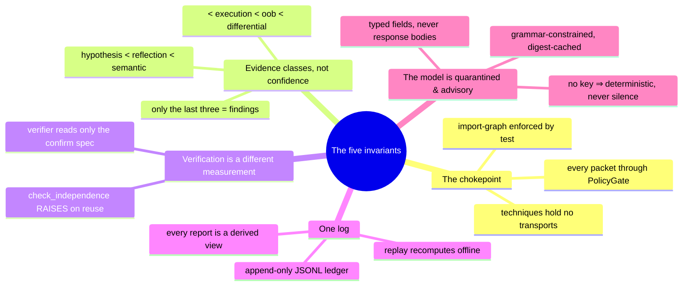

### Invariant 1 — The chokepoint

Every packet that leaves the engine passes through `policy/gate.py`. Techniques
hold no transports; verifiers go back through the gate for their fresh
measurements; the model has no tools of any kind.

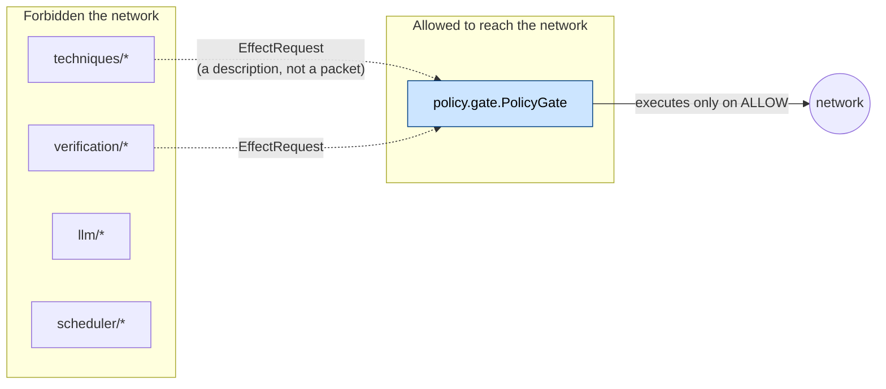

The proof is an import-graph test:
`tests/vuln_engine/test_invariants.py` asserts that no module outside `policy/`
imports any transport module. Even the browser's own outbound subresource
fetches (scripts, iframes a loaded page pulls) go through a
`policy/subresource_gate.py` the PolicyGate builds per navigation — the gate
says who is allowed, the transport intercepts and aborts. A crash inside a
transport is *an unmeasured effect row*, not a dead run.

### Invariant 2 — Evidence classes, not confidence

`kernel/evidence.py` orders evidence:

```mermaid
flowchart LR
    H["hypothesis<br/>a rule or model said so"] -->
    R["reflection<br/>our input came back"] -->
    S["semantic<br/>the context was parsed"] -->
    E["execution<br/>a browser ran the script"] -->
    O["oob<br/>our collaborator saw it"] -->
    D["differential<br/>two states differed"]
    style H fill:#fff3cd,stroke:#ffc107,color:#000
    style R fill:#fff3cd,stroke:#ffc107,color:#000
    style S fill:#fff3cd,stroke:#ffc107,color:#000
    style E fill:#d4edda,stroke:#28a745,color:#000
    style O fill:#d4edda,stroke:#28a745,color:#000
    style D fill:#d4edda,stroke:#28a745,color:#000
```

Green (`execution`, `oob`, `differential`) are **finding grades** (`FINDING_GRADES`).
Yellow may propose and be recorded as a **lead** — never promoted. An LLM saying
"looks like XSS" is grade `hypothesis`; a browser recording that the script ran
is grade `execution`. The ladder is a vocabulary of *kinds of fact*, not a
confidence score: you cannot argue with a measurement class the way you can
argue with 0.83.

### Invariant 3 — Verification is a different measurement in kind

A verifier may not read the proposer's evidence — only the candidate's
**confirmation spec** (which URL, which payload, which oracle). It re-measures
fresh, through the gate, in a different order or class than the proposer used.
`Verdict.check_independence` **raises** `ValueError` if the verifier's grade
equals the proposer's, or if the grade is not a finding grade. It raises rather
than returning a boolean because there is no correct behaviour for a
non-independent verdict — silently downgrading would hide the bug that produced
it.

### Invariant 4 — One log, and a small family of pure derived views

The report cannot claim anything the world log does not contain.
`world/views.py` derives findings, leads, receipts, gate audits, the holding pen,
the novelty map, the LLM cost, the abduction summary, the abduction-cost summary,
**and the eligibility census** *from* `world.jsonl` (for the census, the seed and
registry the run already constructed); `--replay` recomputes a finished run offline
with sockets disabled. There is no second place truth lives — no database the report
also consults, no momentum in a wizard. The census is the newest of these views, and
it is deliberately read-only: it does not schedule, spend budget, or change what a run
does — it exists so the report can name the case the receipt view cannot see.

### Invariant 5 — The model is quarantined and advisory

Junctions (the engine's LLM modules) see typed structural fields — a context
enum, a byte count, a list of probe ids — *never* a target response body.
Answers are validated against fixed shapes; a drifted answer is a *degraded
opinion*, never an exception. With no `VULN_ENGINE_LLM_API_KEY` configured,
every junction returns its degraded result and the engine runs
byte-for-byte deterministically. Untrusted content cannot prompt-inject a model
that is never shown untrusted content.

---

## 4. The mental model — ask, measure, verify, record, derive

Run `python run_engine.py --fixture` and this is what happens, end to end:

```mermaid
flowchart TB
    START["Operator declares<br/>target + surfaces + sessions"] --> ESC["registry.discover()<br/>walk techniques/, validate manifests"]
    ESC --> CL["Classic pass: for every technique × surface<br/>(surfaces() is the technique's own gate)"]
    CL --> HYP["hypotheses(surface)<br/>testable claims"]
    HYP --> PR["probes(hypothesis)<br/>specs, cheap before loud"]
    PR --> GATE["PolicyGate.run(EffectRequest)"]
    GATE -->|ALLOW| FX["transport: http1 / browser / oob"]
    GATE -->|DENY / DEFER| LOGROW["gate.decision row<br/>(an observation, not an error)"]
    FX --> OBS["world.observe: bytes → typed Observations"]
    OBS --> INT["interpret(hypothesis, observations)<br/>→ candidates, or honest zero"]
    INT -->|"deviation, no candidate"| ANOM["anomaly.retained → abductive loop"]
    INT --> CAND["candidates"]
    CAND --> VER["VerificationLayer: independent verifier,<br/>different class, fresh through the gate"]
    VER -->|proven| FIND["Finding (grade: execution/oob/differential)"]
    VER -->|refused| LEAD["Lead — recorded, never promoted"]
    CAND --> ELIG["eligibility_census(seed, registry)<br/>one read-only call per technique<br/>against the full seed"]
    ELIG --> WLOG
    FIND --> WLOG[("world.jsonl (append-only)")]
    LEAD --> WLOG    WLOG --> VIEW["world.views → report.json,<br/>gate audit, holding pen, novelty,<br/>**eligibility census (batch J2)**"]
    style FIND fill:#d4edda,stroke:#28a745,color:#000
    style LEAD fill:#fff3cd,stroke:#ffc107,color:#000
```

The compression hides only one important subtlety: **an arm** is one
technique × one surface pair, and it is the unit of *accounting* — the receipts
ledger (§11) pays for an arm's conclusive answers at most once.

---

## 5. The vocabulary (kernel/)

`kernel/` is contracts only — no logic, no I/O, no clock. It is the first thing
to read in the code because every later file speaks it.

### Surface — the thing being tested

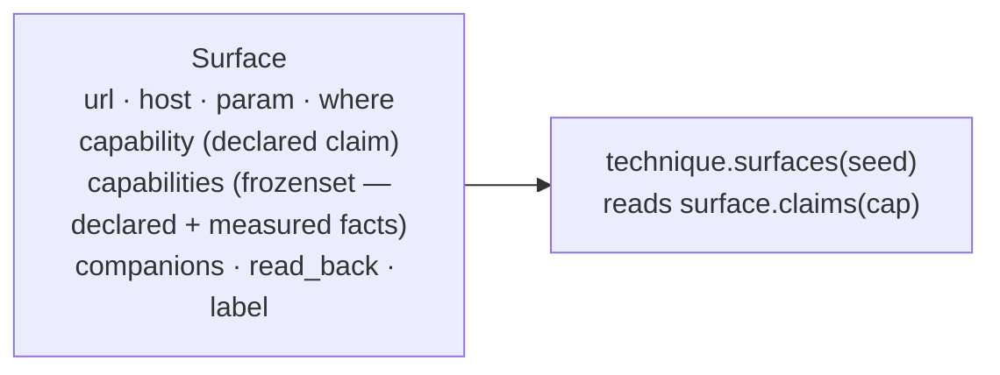

| Field | Meaning |
|---|---|
| `url`, `host`, `param` | the endpoint and parameter under test |
| `where` | `"query" \| "body" \| "path" \| "header" \| "url"` — which part of the request carries the value |
| `capability` | the declared claim — the operator's word, or the graph's strongest derive. Batch J1 (2026-10-20) validates this field against the kernel vocabulary at intake: `parse_surface()` (CLI) and `_to_surface()` (graph bridge) raise `ValueError` for a string not in `CAPABILITIES`, and `validate_seed()` refuses a declared surface whose capability the kernel does not speak with a named `SurfaceProblem`, the same shape as the `where`-gate refusal but **registry-independent**. The old behaviour — silently dropping an unknown value at `declared_facts(seed)` time — is gone. A valid-but-wrong capability still passes intake; it is accepted and then invisible to the wrong technique, which is what the eligibility census (§11/§12) exists to name. |
| `companions` | fixed form fields a body submission must carry (CSRF token, …) |
| `read_back` | where stored input renders back (for stored techniques) |

`key` is `url#param`. Provenance rides on `label` — e.g. `graph:<node>#<param>`
on a recon-derived surface, so a finding traces back to the node recon observed
it on.

### The eight capability claims — the whole gate vocabulary

These are the strings a `Surface.capability` may carry and the kernel will own.
Every consumer is pinned to this tuple, and the intake path now refuses a value
not in it. The meaning column is what a claim *opens*, not what a technique proves.

| Value | Meaning (what it opens) | Who reads it as a gate |
|---|---|---|
| `public_param` | a client-settable parameter | xss_reflected, xss_dom, generic_differential |
| `http_response_reflects_input` | the response contains our input | xss_reflected, xss_dom (alternative gate) |
| `can_influence_remote_fetch` | the server fetches a supplied URL | oob_fetch |
| `delayed_response` | processing time depends on the value | sqli_blind_time, command_injection |
| `server_stores_input` | input is stored and served back | xss_stored |
| `access_differs_by_session` | two identities see different content | idor_differential, generic_differential |
| `script_execution` | **postcondition** — a technique establishes it | chain targets |
| `cross_account_readable` | **postcondition** — object readable across a boundary | chain targets |

The last two are *what a technique proves*, not *what it needs* — carried in the
same vocabulary so chaining is a plain lookup. Spelling matters brutally. There are now three places a wrong capability becomes
visible instead of silent, and only the first two are on the intake path:

* **Wrong-and-unknown at CLI intake** — `parse_surface()` raises `ValueError` for a
  string not in `CAPABILITIES`, restating the kernel vocabulary in the error text (batch
  J1, 2026-10-20).
* **Wrong-and-unknown at the graph bridge** — `_to_surface()` in
  `service/vuln_engine/seed/from_graph.py` raises the same `ValueError` for a
  graph-derived candidate whose `capability` is not in the vocabulary.
* **Wrong-and-unknown at seed validation** — `validate_seed()` refuses a declared
  surface whose capability the kernel does not speak with a named `SurfaceProblem`, the
  same shape as the `where`-gate refusal but **registry-independent**, because capability
  is a kernel constant (batch J1).

The vocabulary is a kernel constant, so the check does not depend on the registry; it
fires even when there is no registry (`registry=None`), unlike the `where`-gate.

The fourth related case is not answered by the intake checks: **wrong-but-valid** (in
`CAPABILITIES` but not what the technique gates on) is accepted and then invisible to the
wrong technique, and the receipt view cannot name it. That is the case the eligibility
census (`world/views.eligibility_census`, batch J2) is written to make visible.

`tests/vuln_engine/test_capability_vocabulary.py` still pins every consumer against
`kernel/technique.py`'s `CAPABILITIES`, so a renamed constant fails loudly everywhere
instead of nowhere — but the *operator-facing* loudness for a bad spell is now at intake,
the graph bridge, and seed validation, not downstream.

### Hypothesis, ProbeSpec, Candidate, Verdict

| Shape | The one thing to remember |
|---|---|
| `Hypothesis` | a *claim* + which capability it rests on + an optional `Expectation` (what "nothing is broken" looks like — violations feed the abductive loop) + a canonical plan with digest |
| `ProbeSpec` | `kind` (`http.request`/`browser.run`), `oracle` (a boolean question, not an adjective), `purpose`:**`propose`** (the driver runs it) vs **`confirm`** (the verifier runs it — a technique that ran its own confirmation would be a closed loop), `noise`, `produces`, `requires_context` |
| `Candidate` | `evidence` (the proposer's grade — a lead grade in every case) + `confirm` dict ("what a *verifier* should do") + `payload` + `repro_url` |
| `Verdict` | `proven` + the *verifier's* `Evidence` + `proposer_grade` kept for the report line ("confirmed by browser execution *(proposed on semantic)*)") |

### The OOB sentinel — how a pure function asks for a URL

A technique is pure: it cannot call the OOB collaborator to obtain a URL.
Instead it emits a sentinel that the driver substitutes:

```
ooburlsentinel_<probe_id>   →   http://host.docker.internal:9009/oob/<probe_id>
```

Alphanumeric-only on purpose — the sentinel travels through percent-encoding,
and must survive it to be findable. The driver logs each substitution as an
`effect.internal` row (our own listener is not the target, so there is no scope
question to ask — but it *is* logged, like everything else).

---

## 6. The life of an arm — the heartbeat

`Engine._run_surface` in `scheduler/driver.py` is the engine's heartbeat. Here
is the whole thing, then each beat explained:

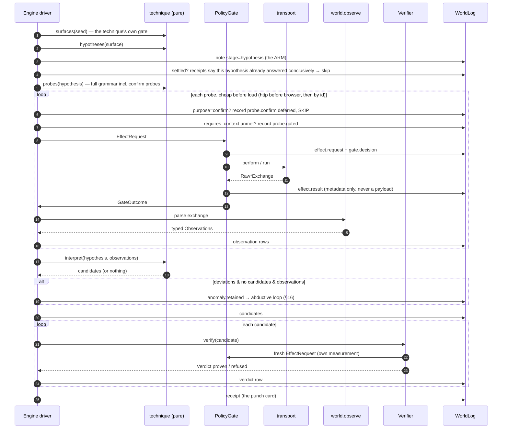

Beats worth stopping on:

- **The arm names the *hypothesis's* surface, not the loop's.** An adapter like
  `generic_differential` can emit seed-level plans from one call; labelling a
  report-surface hypothesis with an invoice surface's arm would file the wrong
  receipt.
- **Confirmation probes are deferred, not dropped.** The technique emits the
  full grammar including its own would-be-confirmation probes — and the driver
  deliberately skips them (`probe.confirm.deferred`), because a technique that
  ran its own proof would be a closed loop. The verifier later re-runs that
  same shape in a *different class*.
- **Context gating.** A probe declaring `requires_context=(context,)` only runs
  once some earlier probe established that context. A browser run is the
  loudest thing the engine owns; running one blind costs the most and proves
  the least.
- **Five outcome tokens**, and the distinction matters more than it looks:
  `none` (conclusive: nothing there), `found` (conclusive: match),
  `failed` (probe errored — **not conclusive**, retried next run),
  `refused` (gate refused — no receipt at all), `gated` (context unmet).
  A conclusive attempt settles the arm; a failure never does.

The same shape is replayable: `run_engine.py --replay <log>` recomputes every
technique's hypotheses/probes/interpret from the log alone and diffs the
candidate ids (`scheduler/replay.py`).

---

## 7. Inside the PolicyGate

`policy/gate.py` wraps the recon platform's dispatcher rather than
reimplementing policy — scope first, then eligibility, then budget. Its own
screens on top:

```mermaid
flowchart TD
    R["EffectRequest<br/>kind · host · detail · _session?"] --> V["_validate()"]
    V -->|"empty host / unknown kind /<br/>missing transport / URL carries another host"| D1["log gate.decision DENY — return"]
    V -->|"a session-B request with no second session wired"| D2["DENY: named refusal<br/>+ hint (--session-b-cookie)<br/>counted in blocked_on_session_b"]
    V -->|ok| LOG["log effect.request<br/>(url, method, markers — never the payload)"]
    LOG --> DISP["dispatcher.decide(host, operation,<br/>evidence_state, budget…)"]
    DISP -->|"DENY / DEFER"| D3["log gate.decision — return<br/>(a budget DEFER on a confirmation<br/>is retryable: B1)"]
    DISP -->|ALLOW| BR["_breaker_open?"]
    BR -->|"5 consecutive transport failures"| DEF["log DEFER — target etiquette"]
    BR -->|no| EX["_execute()"]
    EX -->|"pop _session; if b:<br/>merge session_b_headers"| HTTP["http1.perform / browser.run"]
    HTTP -->|crashes| CR["effect.result crashed=True<br/>+ unmeasured outcome — never a dead run"]
    HTTP -->|ok| RES["log effect.result; breaker reset"]
    RES --> ALLOW["GateOutcome(ALLOW, effect)"]
    style D1 fill:#f8d7da,stroke:#721c24,color:#000
    style D2 fill:#f8d7da,stroke:#721c24,color:#000
    style ALLOW fill:#d4edda,stroke:#28a745,color:#000
```

Details you will need sooner than you think:

- **URL/host agreement**: `urlsplit(url).hostname` must equal the request's
  host — a probe that says one host and carries another's URL would be decided
  against the first and sent to the second. A real bypass from a typo.
- **The session shim.** A request marked `_session: "b"` gets the operator's
  `--session-b-cookie` merged (session B wins on conflicts). No second session
  wired → the request is *refused*, not guessed. `views.blocked_on_session_b`
  counts those refusals split into capability-checks vs candidates — the
  operator-visible list of what a missing cookie is costing the run.
- **The breaker is etiquette, not policy**: transport-level failures (a host
  that stopped answering) open it after 5 consecutive; a 5xx never does (an
  app returning 500s is speaking, not silent). Reset only by an answered
  exchange, never by time.
- **Subresources**: a browser page can fire many requests after one
  authorization, so the gate builds a `SubresourceGate` scoped to the
  navigation's host and the drivers intercept + abort anything else
  (`transport.subresource_blocked` rows).
- **Internal effects**: allocating/reading the OOB collaborator skip scope
  (our listener is not the target) but are still logged (`effect.internal`).

`policy/eligibility.py` is the *program-policy* side: after a finding is
proven, does the bounty program pay for it? Never `ELIGIBLE` — the module
answers `potentially_eligible / ineligible / unknown`, and eligibility never
defaults to yes.

---

## 8. Observations — bytes in, typed facts out

`world/observe.py` is pure: a `Raw*Exchange` (the one hop raw bytes are allowed
to exist, in `kernel/exchange.py`) becomes typed `Observation` rows, and the
bytes are discarded. **No observation payload is ever a string** — a status is
an int, a reflection context is an enum, a timing is an elapsed list.

The centerpiece is the **HTML state machine** (`classify_context`): walking the
document to the reflection offset, it answers one structural question — *where
* in the page did our value land?

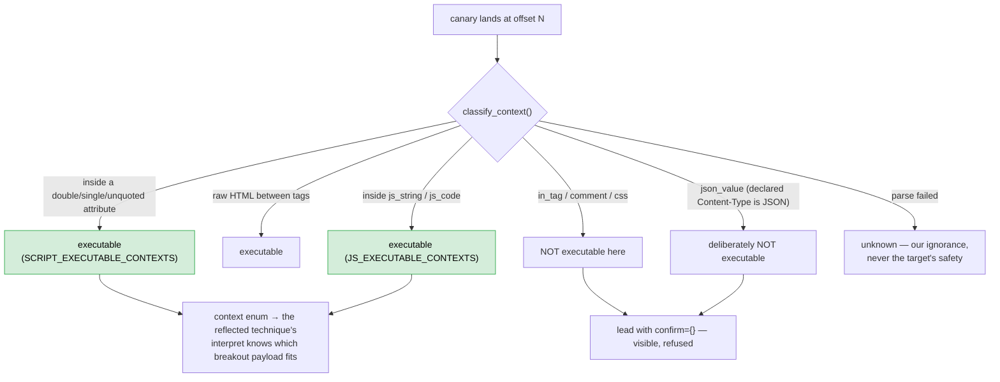

Three honesty rules baked into the lens:

1. **Declared type wins.** `context_for_content_type("application/json")` forces
   `json_value` — an API that echoes our canary is an honest lead naming the
   DOM lens as the follow-up, never an "executable context" invented from
   fiction. (The header is normalized first — `text/html; charset=utf-8` is
   the type it declares.)
2. **Escaped is not reflected.** `is_escaped_verbatim` catches the single most
   common false lead: a server that HTML-escapes its output is *safe* for this
   class, and recording it as "reflected" would manufacture the lead
   ourselves.
3. **`unknown` is dangerous, never safe** (`DANGEROUS_UNKNOWN`) — honest
   ignorance, not a pass.

The DOM lens (`observation.dom_placement`) is different: the *browser* reports
where the value actually landed after parse (`dom_url_attribute`, `dom_text`,
`dom_absent`, …). `xss_dom` reads only placement rows — the two lenses never
answer each other's questions.

Timing is a label, not a kind: the same `observation.http` row carries
`timing_class` (`baseline`/`injected`/dose classes) so interleaved populations
group for the verifier.

---

## 9. Verification — the ensemble

`verification/__init__.py` dispatches on the *confirmation spec's kind* —
after `verification/validator.py` has checked the spec itself (host must agree
with the surface's host; required fields present; the plan's claim shape
provable). A candidate with no confirmation spec is refused with that as its
reason — those refusals are the **leads**.

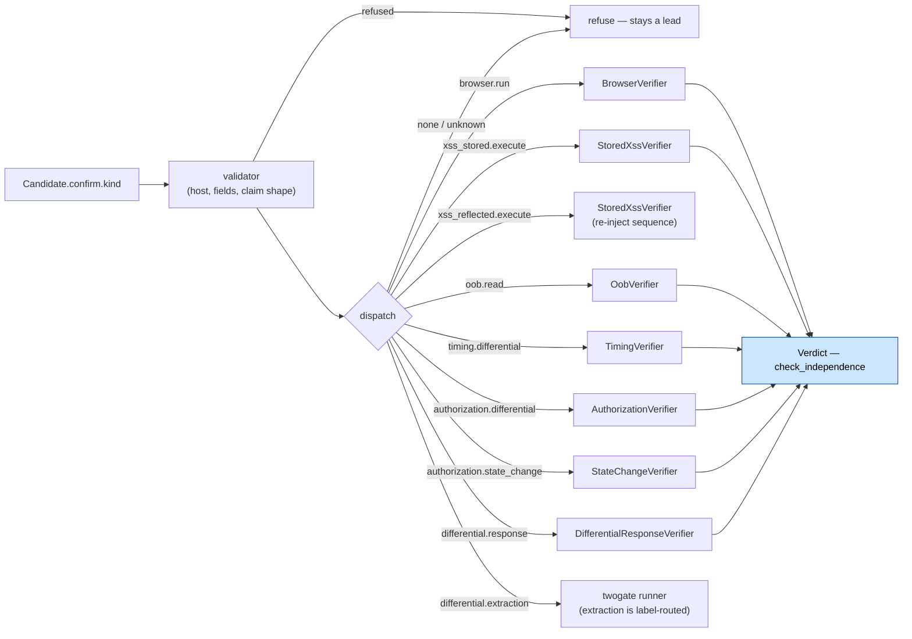

The rules every verifier shares: read *only* the confirm spec; re-measure fresh
through the gate; return `Verdict(proven=True, evidence=grade X)` or `refuse`;
and `check_independence` will raise unless X ≠ proposer's grade and X ∈
`FINDING_GRADES`. Below, what made each verifier the experiment it is (the
master reference §13 has all the constants).

### TimingVerifier — the most-hardened measurement

A timing separation alone proves only *"this input changed how long the target
took"*. Rate limiting, a WAF's regex backtracking or a load blip each produce
that with **no SQL being interpreted**. The verifier's answer was behavioral:

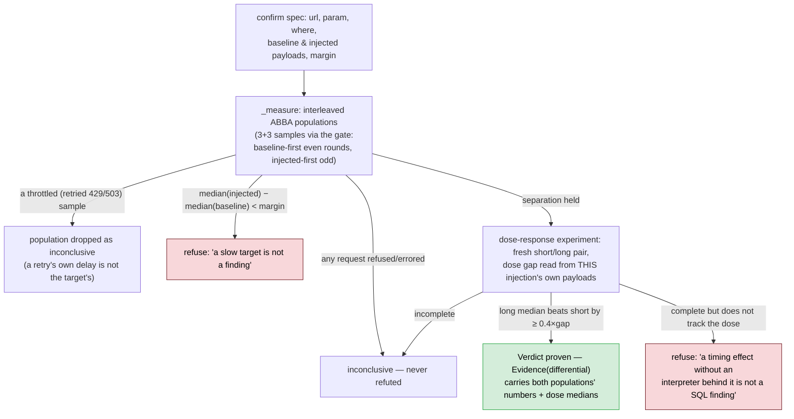

**Why ABBA?** Block sampling (all baseline, then all injected) put any monotonic
drift — a warming target, a rate window, a load balancer rotating backends —
entirely on the second block and *posed as injection*. Interleaving with
alternating order makes a drift's effect symmetric.

### AuthorizationVerifier — flipped order + content agreement

Re-asks the target itself under both declared identities, **session B first**
(fresh requests through the gate — flipping is what makes this a different
measurement in kind from the proposer's). Then status *and* the body:

| Fresh measurement | Result |
|---|---|
| both `2xx` + identical SHA-256 body hashes | **proven** — the boundary the operator declared is absent |
| both `2xx`, B's body empty | refuse — "a 200 that carries nothing is not access to the object" |
| both `2xx`, bodies differ ≥ 50% of the larger | refuse — "a different representation is not proven access" |
| both `2xx`, small drift (≤ 50%) | proven on equivalent content (tokens/timestamps are noise) |
| B in `{301…308, 401, 403, 404}` | refuse — the proposer's pair did not reproduce |
| anything else | inconclusive |

Bodies are hashed and sized, then dropped — only hashes and lengths are logged.

### StateChangeVerifier — "the change at T reaches V", as stated

A flipped two-session read proves only "B can read V" — the weaker, often
*legitimate* claim — while scoring the grade of the strongest. This verifier
re-executes the actor's change fresh (session A) *between* two unchanged victim
reads (session B), with a pre-pair drift control (the two pre-change victim
reads must agree, else refuse: the page itself is moving). Refuses up-front
when no second session is wired, naming the operator fix.

### The rest, in one breath

- **OobVerifier** — did *our* collaborator record a request on the path only
  this probe knows? The strongest class for blind bugs, because something we
  control observed it; an error is inconclusive, never a refutation.
- **BrowserVerifier** — a marker the payload set answered true (only possible
  if the JS ran), or our dialog text. A failed run proves nothing, checked
  first.
- **StoredXssVerifier** — a *sequence* (HTTP re-inject with companions →
  browser read-back requiring execution). Two scars hardened it: the inject's
  status is checked explicitly (a 401 login page is an answered rejection,
  not a store), and every proof is **nonce-bound** — the verifier mints a
  nonce, substitutes it into the payload's own dialog token, and requires it
  back — so a stale entry stored by a previous run cannot prove today's
  finding.
- **DifferentialResponseVerifier** — status/length/hash differential with two
  *preconditions* before the oracle reads anything: the **noise floor** (every
  population measured with samples whose repeats agree — a token-stamped page
  cannot support a differential at all) and the **neutral control** (control ≅
  baseline). Both blocked → inconclusive, namelessly blocked otherwise.

`verification/registry.py` is the verifier vocabulary as first-class records
(`confirm_kind`, `measurement`, `claim_shapes`, `re_executes_setup`);
`check_alignment(CONFIRM_VERIFIERS)` is empty or a test fails — the dispatch
table and the vocabulary registry cannot drift.

---

## 10. Techniques — the corpus

A technique is **four pure functions and a manifest** — no I/O, no clock, no
model. The driver composes them; the folder *is* the registration
(`registry.py` discovers, validates manifests loudly, and skips a half-built
folder with a logged reason).

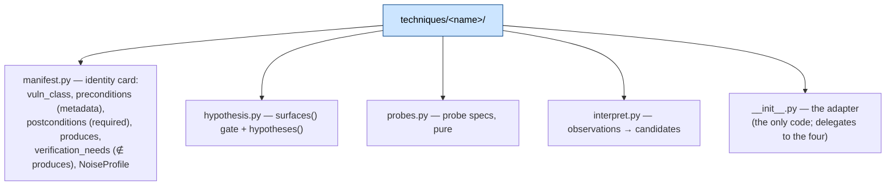

### The one table that decides what can fire

`surfaces()` is **the gate** — the authority on which surfaces the technique is
actually offered. The manifest's `preconditions` are metadata, and they are
*allowed* to disagree (five of the eight differ; `test_inventory_pins.py`
pins the count — deliberately, as a noise-budget decision):

| Technique | Class | Manifest says | `surfaces()` gate | Verified by |
|---|---|---|---|---|
| `xss_reflected` | xss | `public_param` | `public_param` **or** measured `http_response_reflects_input` | browser (execution) |
| `xss_dom` | xss | `public_param` | same OR | browser (execution) |
| `xss_stored` | xss | `server_stores_input` | `claims(server_stores_input)` | stored runner (execution) |
| `oob_fetch` | ssrf | `can_influence_remote_fetch` | declared **or** measured | collaborator (oob) |
| `idor_differential` | idor | `access_differs_by_session` | `claims(...)` | authorization (differential) |
| `sqli_blind_time` | sqli | `public_param` | **`claims(delayed_response)`** | timing (differential) |
| `command_injection` | command-injection | `public_param` | **`claims(delayed_response)`** | timing (differential) |
| `generic_differential` | method-confusion | `public_param` AND `access_differs_by_session` | **either**, declared or measured | differential |

Read the `sqli` row twice: the manifest says `public_param` and the *gate*
says `delayed_response`. To make a timing technique fire, either declare
`delayed_response` on the surface, or run `--elicit` and let the timing
elicitor measure it. And both timing techniques read the **same** claim on the
same surface — two hypotheses for one fact — which one is right is
measurement's job, not the operator's: the farmer declares "this input moves
response time"; `sqli_blind_time` and `command_injection` each propose *why*.

### The gates read `claims()` — declared *or* measured

Since Capability Closure (§13) every gate reads the surface's *established*
claims, not just the operator's string. That is why the table says "declared
**or** measured" four times.

### Worked example — `sqli_blind_time`

The loudest probe set in the engine (6 baseline + doses, 0.9 burstiness):

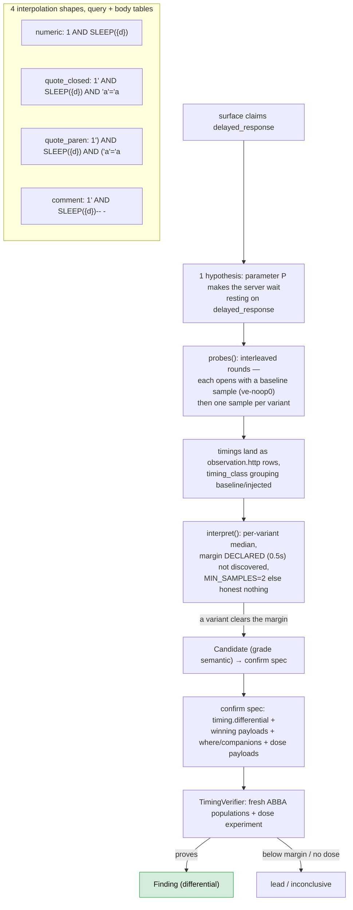

Three honesty rules inside `interpret` worth absorbing, because every
technique copies them: the margin is **declared**, never discovered; an
incomplete population proposes **nothing**; the winner is the **variant**
(single named injection), not the family — and the confirm spec carries that
variant's payloads (plus dose payloads) so the verifier measures what was
actually proposed.

### `generic_differential` — hypotheses as data

The structural oddball, and the reason the engine can compose: its
vulnerability knowledge is **plan rows**, not code. `plan.py` defines
`DifferentialPlan` (two behaviors + a `claim_shape` + expected/denied statuses)
with builders like `object_read_plans(surfaces)` and
`session_role_plans(targets, victims)`; `eligibility.py` *derives* the gate
from the plan table at import (an OR of `public_param` / `access_differs_by_session`)
and refuses to load into something inert. `interpret` is fixed code applying
one comparison to every row — the vuln-class knowledge lives in the rows. The
same plan table is what the abductive loop (§16) composes from: a proposal is
data, materialized through the technique's own `hypothesis_for_proposal` hook,
and run through the ordinary gate/interpret/verify path.

### Position matters: `where`, and the two loud seed gates

The shared helpers in `techniques/common.py` shape every payload for its
position: `with_parameter` (query, percent-encoded — a mangled payload is
indistinguishable from a sanitized target), `json_body_request` (body),
`header_request` (a request header named after the parameter), and
`with_url_parameter` (substitutes into a `{param}` placeholder in the path —
raises loudly when the URL spells no placeholder).

The seed validator (`service/vuln_engine/seed/validate.py`) now runs **two**
loud checks before any scheduling work, and both exit the CLI with exit 2 naming
the refused surface and a reason:

* **The `where`-gate** (batch 2, Phase 4): a surface declared at a position no
  registered technique's probing grammar accepts is refused. The accepted set is
  derived from the registry (`TechniqueRegistry.accept_where` — a manifest's
  `gate_where` when it declares one, the classic core default otherwise), so a
  technique that starts accepting `header` or `url` widens the set by declaring it.
* **The capability-vocabulary gate** (batch J1, 2026-10-20): a declared surface
  whose `capability` is not in `CAPABILITIES` is refused with a named reason, the
  same shape as the `where`-gate refusal — but **registry-independent**, because
  capability is a kernel constant. It fires even when there is no registry
  (`registry=None`), unlike the `where`-gate. An unknown capability no longer
  silently reaches `declared_facts(seed)` and gets dropped there.

A surface can fail both: when that happens, both problems are reported, and the
operator action differs by the first one that matters (re-declare the position, or
fix/replace the capability spelling). A valid-but-wrong capability does **not**
trigger this gate — it is accepted and then invisible to the wrong technique, and
that case is what the eligibility census (§12) names.

---

## 11. Scheduling — spending visibility well

Two runtimes share one idea: **the budget is visibility** (requests a target or
WAF sees), and the engine should buy information per unit of it.

### The single pass (`Engine`)

Deterministic enumeration: every technique × surface it
accepts, cheap probes first. Findings land in the ledger; receipts make the
run idempotent (a conclusive attempt is not paid for twice unless `--force`).

### The campaign (`scheduler/campaign.py`)

Rounds of UCB-driven selection over arms — receipts from the ledger are the
history, declared `NoiseProfile.cost` is the price of asking:

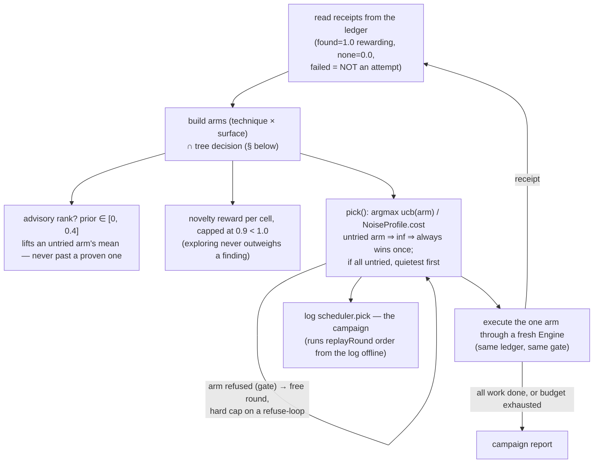

The UCB math (exact): `mean = (rewards + prior + novelty) / throws`,
`optimism = c·√(ln N / throws)` halved after 2 consecutive `none`s,
`score = (mean + optimism) / cost`. Constants: `REWARD_FOUND = 1.0`,
`DEFAULT_EXPLORATION = 1.4`, novelty cell decay 0.5, reward cap 0.9.

### The attack tree (`scheduler/tree.py`)

AND/OR structure over the same arms: to prove impact you often need *this* AND
*that*; either may come from several techniques (OR). Unreachable AND edges
**park** — their arms invisible to the selector; the campaign logs the parking
decision (`stage=scheduler.tree`) and says why when the root is parked.
Satisfaction is always recomputed from the *log*, so a replayed campaign
re-derives the same parking.

### Hypothesis pool & novelty cells

`abduction`-proposed experiments pool in memory per run (`scheduler/pool.py`),
keyed by cell; `novelty_cells_from_log` pays a decaying reward to cells whose
arm actually ran (a proposal whose experiment never ran earns nothing).
Memory-corroborated proposals rank first (§17).

---

## 12. The world log — the only truth

`world/log.py`: append-only JSONL. No `set`, no `update`, no rewrite. Rows
carry `at` *passed in by the caller* (no clock inside the engine — passing
timestamps in is what makes a run reproducible). `log.since(started)` gives a
read-only window, **so a report is about its own run even when the file spans
many runs** (cumulative directories are the norm; `--run-id`/`--fresh` name
run dirs explicitly).

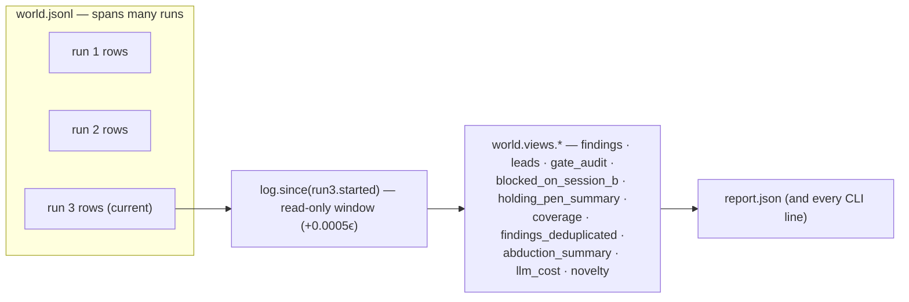

Row vocabulary highlights (full table in master reference §22.1):

| Row | Meaning |
|---|---|
| `run.begin` / `run.end` | the run's envelope + counts |
| `effect.request` / `effect.result` / `effect.internal` | every packet, metadata only — payloads never reach the ledger |
| `gate.decision` | ALLOW/DENY/DEFER with the reason — a refusal is an observation |
| `observation` | typed observation rows (rebuilt as dataclasses for replay) |
| `note` | stage markers (`hypothesis`, `probe.gated`, hypothesis.abduced, scheduler.tree …) |
| `candidate` / `candidate.junction` | proposers' output (the junction flavor marks model provenance) |
| `verdict` / `receipt` | the referee + the punch card |
| `anomaly.retained` / `abduction.proposed` / `abduction.validated` / `holding_pen.entry` | the abductive loop's trail (§16) |
| `capability.measured` / `capability.absent` | measured precondition facts + their negatives (§13) |
| `llm.junction` | every model call, digest-keyed, cost-stamped (§15) |
| `scheduler.pick` | the selector's decision (campaign replay) |

Views (§10.2 in master) are pure functions of the window: `findings`,
`leads`, `receipts_by_arm`, `gate_audit` (with `uncleared_effects` — computed,
zero by *construction*, so a future refactor that breaks it yields a number
instead of silence), and the operator-facing optics: the holding pen backlog
grouped by `(needs_verifier, class)` and sorted by value, deduplicated
findings (strongest per `(surface, class)`, duplicates carried), coverage (the
last outcome per surface×technique), abduction funnel and the joined
abduction cost view.

**Replay** (`scheduler/replay.py`): rebuild observations by probe, re-run each
technique's pure pipeline, diff logged vs recomputed candidate ids, and report
mismatches + independence violations. The deterministic abduced round is
recomputed from the annotated anomaly; model-sourced rows are *listed as
recorded fact* — the log wins either way.

---

## 13. Capability Closure — measuring preconditions

The scar this closes: a technique's gate reads a capability claim, and every
source of that claim used to be *declaration* — an operator `--surface
...;capability=…`, or the graph bridge's name-hint. **Nothing could establish
one.** So on a target the operator had not pre-guessed, a perfectly good
technique (`sqli_blind_time`, `oob_fetch`…) was an inert arm with no error and
no signal — and the engine's own docstring about it said so out loud.

The insight: the engine already owns every instrument — each measurement lived
inside a verifier. An **elicitor** is a verifier with the candidate removed:
same probe discipline through the same gate, but the question is "what is true
of this surface" instead of "is this bug true". The answer is a `CapabilityFact`
— a claim with an ordinary `EVIDENCE_*` grade — written to the ledger as
`capability.measured` (negatives as `capability.absent`, so an already-asked
closed question is skipped but never read as open).

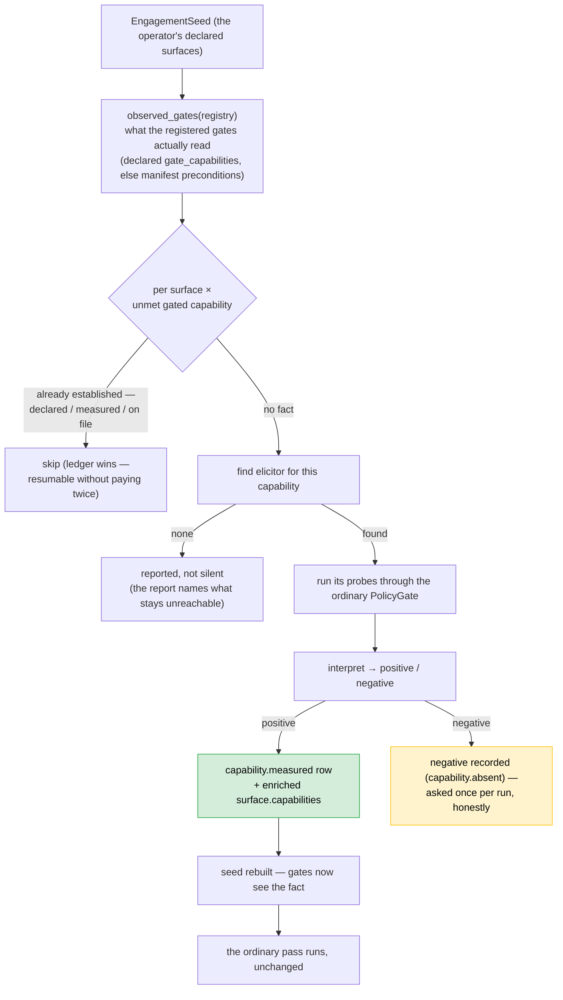

Run with `--elicit` because elicitation *is traffic* (sleep doses, second-identity
reads) — opt-in at every layer, pinned by test. The elicitor corpus
(`elicit/`, one folder per capability, same folder-is-registration shape):

| Elicitor | Establishes | Grade | Its own honesty rule |
|---|---|---|---|
| `public_param` | `public_param` | differential | a **pair**: canary in the param vs an ignored name — a param the app *ignores* also echoes canaries in some frameworks; positive only if the pair differs |
| `reflection` | `http_response_reflects_input` | reflection | its own canary, distinct from the XSS family's |
| `remote_fetch` | `can_influence_remote_fetch` | oob | an interaction on *our* collaborator; no arrival is a negative |
| `timing` | `delayed_response` | differential | quiet vs sleep **plus a dose-response pair**; must track the dose |
| `sessions` | `access_differs_by_session` | differential | one read per identity; status or ≥50% body-length difference |
| `storage` | `server_stores_input` | reflection | the canary must return on the **read-back** request, not the submit's own echo |

A fact is not a finding — it opens a door; the vertex above it still has to pay
full propose → gate → *independent verifier in a different class*.

The **two-gate flow** (§14) is the same philosophy with a prober instead of a
closure pass, plus a whole confirm-spec vocabulary — read on for when to reach
for which runtime.

---

## 14. The two-gate flow

`run_twogate.py` → `service/vuln_engine/twogate/`. Same gate, same transports,
same ledger discipline as the classic engine — but eligibility is *measured*
(the prober) rather than claimed, and confirmation is a declarative
`ConfirmationSpec` executed by a deterministic oracle. A run directory hosting
`twogate.jsonl` classifies itself as a two-gate run everywhere (the UI reads
the ledger-file name, not the location).

```mermaid
sequenceDiagram
    autonumber
    participant CLI as run_twogate.py
    participant Pr as CapabilityProber
    participant Ag as CapabilityAgent
    participant Pl as ConfirmationPlanner
    participant VA as VerifierAgent
    participant Ru as ConfirmationSpecRunner
    participant Lo as WorldLog (twogate.jsonl)

    CLI->>Lo: run.begin (target, stopping criteria)
    CLI->>Pr: measure(seed)
    Pr->>Lo: capability.measured rows (6 capabilities × surface)
    loop per surface, up to max_rounds
        CLI->>Ag: propose(surface, capabilities, history)
        Ag-->>CLI: proposal (label + vuln class) or none → stop
        CLI->>Lo: loop.round
        CLI->>Pl: plan(proposal, capabilities)
        Pl-->>CLI: Planned(routine) or Lead(reason)
        Pl->>Lo: lead.classified (if Lead — named reason)
        Pl->>VA: spec_for(proposal, routine, surface)
        VA-->>CLI: ConfirmationSpec (digest = replay key)
        CLI->>Lo: confirmation.spec
        CLI->>Ru: run(spec)
        Ru->>Ru: gate-mediated traffic; oracle over Features
        Ru-->>CLI: ConfirmationResult proven / refused / inconclusive
        CLI->>Lo: confirmation.executed (or .refused)
        CLI->>Lo: candidate + verdict rows (ordinary vocabulary)
        Note over CLI,Ru: a refutation loops; the next round hypothesizes a DIFFERENT bug
    end
    CLI->>Lo: run.end → findings/leads derived from the window
```

Key shapes:

- **Routines** (`twogate/routines.py`, 9 of them: `xss.browser.v1`,
  `sqli.timing.v1`, `command_injection.timing.v1`, `sqli.extraction.v1`,
  `ssrf.oob.v1`, `idor.authz.v1`, `method_confusion.response.v1`,
  `path_traversal.response.v1`, `xss.stored.v1`) are one *playbook* each — the
  payload family, the oracle, samples, margin. The verifier agent selects by
  id; it does not invent test cases. The proposer cannot see this corpus.
- **The planner routes** deterministically and enforces independence *before*
  the verifier agent is asked — the proposer can never steer the choice of
  verifier (the one place the design refuses to share power).
- **One measurement, both runtimes**: the runner delegates `timing.differential`
  and `authorization.differential` to the classic verifiers through
  `kernel/confirm.py`'s shared `ConfirmSpec`; `differential.response` is
  answered classically by `DifferentialResponseVerifier`;
  `differential.extraction` (`sqli.extraction.v1` — asking the target to
  *compute* a sentinel, so plain reflection cannot satisfy it) stays
  runner-only. `test_route_parity.py` pins the mapping both ways.
- **`data_extracted`**: the extraction oracle's payloads compute the canary
  (`0x76652d…` / `CHAR(118,…)`) rather than spelling it — a reflecting target
  echoes the *encoding* and fails; only a target running the injected query
  returns `ve-extract`.
- **Stopping criteria** are logged at `run.begin`: 3 rounds/surface,
  12 candidates/surface, 8 capabilities/surface. A found candidate stops the
  surface; refutations loop into *different* proposals.
- Model advisors (`twogate/advisor.py`) may re-order labels within the measured
  set or pick a payload within a routine's family — they cannot invent either.

When to reach for which: classic is the default operator surface (declarations,
campaigns, trees, abduction); two-gate is the *measured-capability* instrument —
point it at a target whose preconditions nobody declared and it finds which
doors open by itself.

---

## 15. The LLM advisory

`llm/` — one door (`client.py`), pure junctions, a runtime (`runtime.py`) and
the `Advisory` assembly (`wiring.py`). The contract:

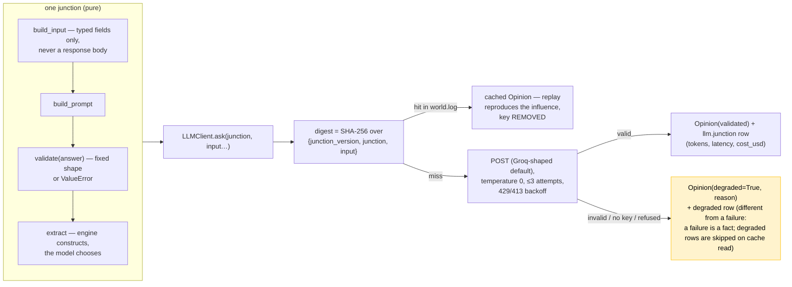

The junctions, and the *single thing each may influence*:

| # | Junction | Wired to | May | May never |
|---|---|---|---|---|
| 1 | `rank` | campaign arm priors | lift an arm's mean, ≤ 0.4 total mass 1.0 | outrank a measured finding, veto a pick |
| 2 | `synthesize` | driver's extra canary | one propose-purpose probe from the technique's declared grammar | touch a verdict; run ungrammatically |
| 3 | `write` | report draft | paraphrase typed fields ≤ 5 sentences, flagged | assert an unattributable claim |
| 4 | `hypothesize` | seed widening (operator request only) | propose URLs recon actually observed | propose unobserved URLs (whole answer degrades) |
| 5 | `reflect` | driver's empty-arm recheck | re-ask ONE probe the pass already ran, ≤ 2 rounds | direct new spend (recheck names a probe that did not run → refused) |
| 6 | `graph_nav` | recon graph exploration | ≤ 8 tool-steps answering with node ids | conclude anything (ids are expanded by deterministic code) |
| 7 | `abduce` | abduction channels | propose claim shapes the engine speaks, from the plan table | invent a shape, unbounded output |

**Rules pinned by `test_invariants.py`:** no junction raises on bad output; no
network without a key; no response body ever reaches a junction; `llm/` imports
kernel/world only — never techniques, scheduler or transports (the
synthesis grammar travels *as an argument*, which is why deleting a technique
folder cannot break the junctions).

Quarantine is invariant 5 — loosening it is a product decision with a written
threat model, and nothing in this codebase makes that decision for you.

---

## 16. The abductive loop

The phase-4 machinery: what happens when a clean measurement *violates* a
hypothesis's declared expectation — a surprise.

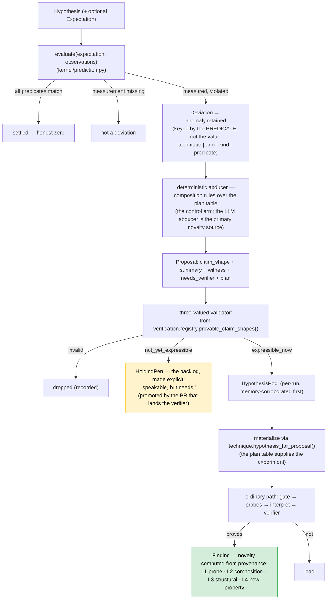

Four rules worth memorizing:

1. **A deviation is never evidence** — it is a *question*; only the ordinary
   verifier can turn an explanation into a finding.
2. **The anomaly key is the predicate, not the value** — two runs violating the
   same predicate on the same surface are the same anomaly seen twice.
3. **The pool is in-memory and per-run; the pen and the anomaly ledger are
   append-only files** (`world/anomalies.jsonl`, the pen's own ledger) — and
   the driver logs `holding_pen.entry` rows to the world log with
   `needs_verifier`/`claim_shape` so the backlog is derivable from the ledger.
4. **Novelty levels L0–L4 are recomputed from log provenance** (`world/novelty.py`)
   — never asserted, never moved by memory. An honest L3 was measured live on
   the fixture; anything beyond is claimed nowhere.

Property proposals (the second channel, A3) come from static context alone,
pool exactly like anomaly-driven ones, and skip re-proposing an experiment the
ordinary pass already ran.

---

## 17. Memory

The memory pair (both halves wired):

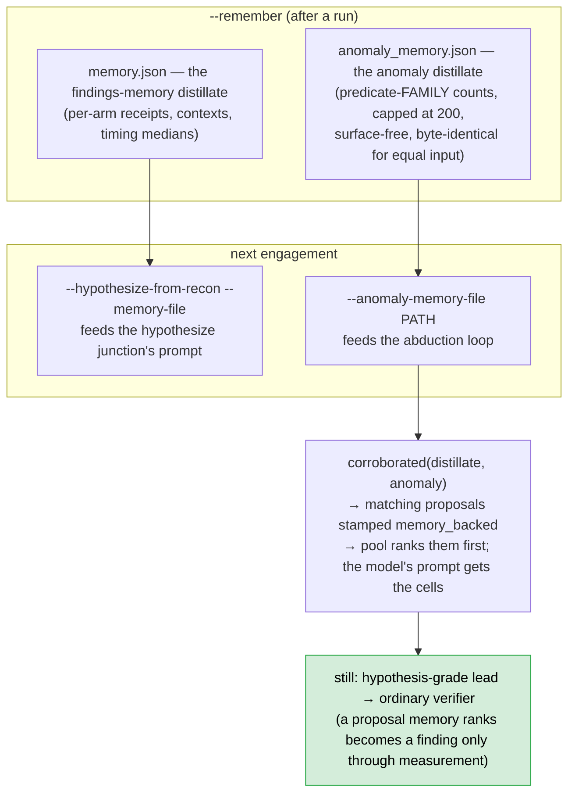

The distillate is **surface-free by design** — the recurring thing across
engagements worth remembering is *which predicate families keep surprising us*,
not which host; the host belongs to the ledger. It is advisory input to the
abduction loop and CLI only — `test_inventory_pins.py` fails the day a
transport, verifier or the gate imports it, because a memory file that could
route a packet or grade a verdict would not be memory. What it cannot do
(yet — §24 of the master reference): prefer a proposal that previously *proved*
(success-aware memory is unbuilt), or demote one that previously failed.

---

## 18. The graph→seed bridge

`seed/from_graph.py` turns recon's `graph_state.json` into engine `Surface`s:

```mermaid
flowchart LR
    G["graph_state.json / Neo4j (GraphBackend)<br/>url · service · cloud nodes"] --> W["deterministic walk:<br/>url nodes + observed_parameter edges<br/>(+ service ports → endpoint surfaces;<br/>+ cloud buckets: open/dangling only)"]
    W --> SCOPE{"scope_state(host)?"}
    SCOPE -->|"out_of_scope / needs_review"| DR["skip + count"]
    SCOPE -->|in scope| EV{"evidence state?"}
    EV -->|"dead"| DR
    EV -->|"historical (unless --graph-include-historical)"| DR
    EV -->|"live"| LOC["where ← edge's props.location<br/>(query/body/path — unknown locations skip+count)"]
    LOC --> CAP["capabilities ← public_param<br/>(+ can_influence_remote_fetch on URL-shaped names —<br/>a hint, never a fact)"]
    CAP --> M["merge_surfaces: declared wins the claim/label,<br/>derived capabilities UNION"]
    M --> S["Surface(label=graph:<node>#<param>)"]
    style M fill:#d4edda,stroke:#28a745,color:#000
```

Two rules make it safe to trust: **code navigates, the model does not** (a
re-run yields the same surfaces in the same order; a replay works with the key
removed), and **a derived surface is a claim, never a conclusion**. The measured
catch: recon is passive, so the graph alone supplies a narrow set of claims —
two of the eight techniques can fire from the graph alone; the rest need
`--elicit`, the two-gate prober, or an operator. Service and cloud nodes arm
nothing in the classic pass paramless (the two-gate prober or the world model
consumes them), and everything skipped is counted in the report rather than
silently dropped.

---

## 19. The UI

`service/ui/` — a stdlib, loopback-only, read-only web app over the artifacts
the pipelines already write (program documents, recon logs/graphs, engine
run overviews, the world-log stream, per-run `/api/trace` — one step per ledger
row for either flow). It can also *start* the same CLIs the operator runs, as
subprocesses from a fixed flag whitelist — never a shell — with `X-Requested-With:
vuln-engine` required on every POST (browser-unreachable writes), a bearer
token mandatory when `--expose` is used, and every client-supplied name
path-checked through the same `safe_component` allowlist the CLIs enforce at
their own parse. Degrade, never 500: a missing artifact is an honest empty
payload with a reason.

---

## 20. The lab — run it yourself

```bash
# 1. bring the target up
docker compose up -d fixture_app oob_collaborator

# 2. the classic run — 2 findings expected
python run_engine.py --fixture
# → output/vuln_engine/<target>/<run-id>/world.jsonl + report.json
# expect: ssrf (grade oob) + xss (grade execution), 0 uncleared effects

# 3. read the ledger — the engine has no UI truth, you ARE the UI
grep '"type":"candidate"' output/vuln_engine/*/*/world.jsonl | head

# 4. replay it offline (sockets disabled)
python run_engine.py --replay <that world.jsonl>

# 5. measure preconditions instead of declaring them
python run_engine.py --fixture --elicit
# → capability.measured rows + the same 2 findings, from a clean output dir

# 6. the measured-capability runtime
python run_twogate.py --fixture

# 7. hermetic tests — no network, no Docker needed for most of it
python -m pytest tests/vuln_engine -q
```

**Exercises** (each one teaches a concept better than a paragraph would):

1. In the ledger, find the `probe.confirm.deferred` rows. Why did the driver
   not run those probes, and who did? *(Invariant 3; §6, §9.)*
2. Find a `gate.decision` row with `verb=DENY`. What reason string does it
   carry, and what would you have declared to turn it into an ALLOW? *(§7.)*
3. Hand-declare a surface on the fixture with the wrong capability
   (`capability=script_execution`). How many arms run — and is there an error?
   *(None; no error — `script_execution` is a valid vocabulary word, so intake
   accepts it. The capability is simply not what any technique gates on, so the
   eligibility census now shows it as a `<technique>: 0 eligible surfaces` line
   in the report. That is the named-visualization case, not the intake-refusal
   case. See §5 and Appendix J2 in the master reference.)*
4. Change `TimingVerifier`'s margin in a scratch copy and prove a lead that
   previously refused. Then break `check_independence`'s grade equality and
   watch the test — not the run — fail. *(Epistemics live in code, not config.)*
5. Delete a technique folder in a scratch checkout. What breaks? *(Nothing —
   folder-is-registration. Run `python -m pytest tests/vuln_engine -q` to see.)*
6. Replay step 2's log with the LLM key *removed* if you ran with one, and
   diff the reports. *(The cached opinion is in the ledger.)*

If a diagram in this document contradicted the code, the code wins and the
diagram is a bug — fix the document the same way the master reference does.

---

## 21. Contributing — the three checklists

### Adding a technique

1. Create `techniques/<name>/` with `manifest.py` + `hypothesis.py` +
   `probes.py` + `interpret.py` + the adapter. Import the kernel with
   *relative* three-dot imports.
2. Requirements the registry enforces: `name == folder`; `postconditions`
   non-empty; `produces` non-empty, every entry a known evidence class;
   `verification_needs` known, and **not** in `produces`; `gate_where` covers
   every position it aims at.
3. Declare `gate_capabilities` (the exact tuple your `surfaces()` reads) so the
   closure pass measures what you actually gate on — otherwise a manifest-only
   precondition silently measures nothing.
4. The oracle must support *independent confirmation*, or the technique can
   only ever produce leads — this is the fence most generated-technique
   proposals fall at.
5. Run: `pytest tests/vuln_engine -q`, `mypy service/vuln_engine`,
   `test_invariants.py` must stay green (no I/O, no clock, no transport
   imports; all observations typed).

### Adding an elicitor (`elicit/<capability>/`)

Same folder shape; manifest exposes `MANIFEST` + `ELICITOR`; its
`preconditions[0]` *is* the capability it establishes and it must be a kernel
`CAPABILITY`; a negative is a recorded answer (of `capability.absent`), never
a silence; noise is real — declare a `NoiseProfile` and run bound.

### Adding a verifier / confirm kind

Add the `ConfirmVerifier` dispatch entry and the `VerifierKind` registry record
in the same change — `check_alignment` fails on drift — plus a claim-shape
decision (is your shape provable as stated, or weaker than you think?
§13's history is the cost of guessing wrong), and route parity with the
two-gate flow if the kind can ride a routine (`test_route_parity`).

**The invariant checklist any change must keep** (all pinned by tests):

- [ ] A technique can never confirm its own finding.
- [ ] Only `execution`/`oob`/`differential` support findings.
- [ ] Every packet through the gate; every decision logged with its reason.
- [ ] Receipts file only executed attempts; nothing conclusive is paid twice.
- [ ] The log stays append-only; every `at` passed in; reports window-scoped.
- [ ] Every observation payload is a typed dict — never a raw string.
- [ ] A module outside `policy/` never imports a transport.
- [ ] The model never sees a response body, holds no tools, and degrades to a
      deterministic engine.
- [ ] A replay recomputes a run offline and matches it.

---

## 22. Where to next

- **The code, in reading order:** `kernel/technique.py` + `kernel/evidence.py`
  (the vocabulary) → `scheduler/driver.py` (`_run_surface` — this doc's §6 in
  code) → `policy/gate.py` → `verification/__init__.py` + one verifier →
  `world/log.py` + `world/views.py` → `llm/client.py` + the smallest junction →
  one technique folder end to end → `elicit/closure.py` → `twogate/spec.py`.
- **The reference for everything this doc compressed:**
  [`VULN_ENGINE_MASTER_REFERENCE.md`](./VULN_ENGINE_MASTER_REFERENCE.md) —
  every module, constant, env var, flag, and the full decision record (§23)
  and roadmap (§24).
- **The research record — how the subsystems you just learned came to be, what
  remains unbuilt, and why:**
  [`VULN_ENGINE_RND.md`](./VULN_ENGINE_RND.md).
- Puzzles worth doing while you read: why is `non-executable` the right default
  rather than `unknown`? (`json_value` in §8.) Why does the arm key on the
  *hypothesis's* surface? (§6 beats.) And why does the verifier, not the
  technique, own `SAMPLES`? (§9 — the proposer declares *what* to inject;
  the verifier decides *how well* it must be measured.)
