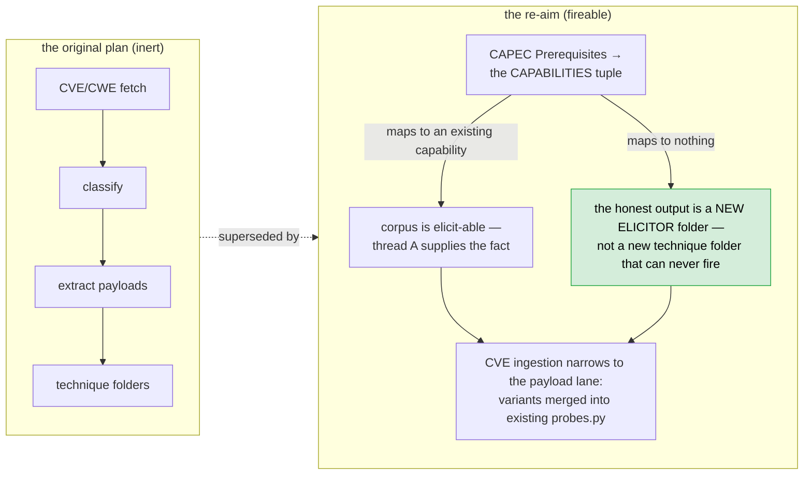

# The Vuln Engine — consolidated R&D record

> **What this is.** The single R&D record for `service/vuln_engine/`: four
> research threads — their problems, designs, what was implemented, what was
> deliberately deferred, and what remains open. It consolidates (2026-10-20)
> four previously separate documents: `RND_dynamic_preconditions.md`,
> `TWO_GATE_RESOLUTION_ASSESSMENT.md`, `CVE_ingestion.md` and
> `EXTERNAL_REVIEW_TRIAGE.md` — the same reasoning, one place; the originals
> are in git history.
>
> **How to read it.** Each thread is self-contained. Statuses are honest:
> *built*, *partially built*, *deferred*, *unbuilt*. This file is the design
> and research record; the code is the truth ([`VULN_ENGINE_MASTER_REFERENCE.md`](./VULN_ENGINE_MASTER_REFERENCE.md)
> carries the module maps and the decision record §23), and the
> [`onboarding deep dive`](./VULN_ENGINE_ONBOARDING_DEPTH.md) teaches how the
> built subsystems work.
>
> Threads at a glance:

| Thread | Idea | Status |
|---|---|---|
| **A — Dynamic preconditions** | measure the preconditions a technique gates on, instead of requiring them declared | **Built** — `elicit/`, `--elicit` |
| **B — Two-Gate Resolution** | measured eligibility → proposed bug → declarative confirmation run by a deterministic oracle | **Built** — `twogate/`, `run_twogate.py` |
| **C — CVE/CAPEC ingestion** | turn public vulnerability data into reachable techniques | **Unbuilt** (stages 1–2 verified against live APIs; the required re-aim is below) |
| **D — External review triage** | three outside reviews; verified verdicts and the fix list | **Resolved** — Appendix D of the master reference |

---

## Thread A — Dynamic preconditions: making the engine *establish* what it assumes

*Status: **built and verified** (Capability Closure, §12.10 in the master
reference). The design reasoning is preserved here; the residuals are in the
master reference §24.*

### A.1 The problem, stated precisely

The original framing was "unless the perfect pre- and postconditions are met,
the engine cannot encounter bugs even if it has them in its glossary." The code
said something sharper: **the engine did not test its preconditions — it
required them to be declared, and it had no way to establish them.**

The chain that locked every technique's `surfaces()` gate:

```python
# techniques/oob_fetch/hypothesis.py
if not surface.param or surface.capability != CAP_INFLUENCE_REMOTE_FETCH:
    return []                      # never fires
```

`surface.capability` was a single string set at seed construction. Three
sources set it, all *declaration*:

1. the operator's `--surface "...;capability=…"` flag;
2. `seed/from_graph.py`, hardcoding `public_param` for every parameter, and
   upgrading to `can_influence_remote_fetch` only on a 28-name *name heuristic*
   (measured against the live `qbsco.net` graph: 35 parameters, zero matching,
   so even the guess never fired);
3. nothing else.

So the capability a technique gates on was a claim about the world that nothing
measured — inside an instrument built to eliminate exactly that trust. The
kernel's own comment said it out loud: a capability we cannot measure cheaply
should be a claim that produces a lead, never a fact.

Two downstream traps followed:

- **"Ingest more CVEs" does not fix it.** Every new technique inherits the same
  gate. Correctness of a technique is unrelated to whether it can ever run.
- **The postcondition half was the same defect mirrored.** All eight manifests
  declared postconditions, but nothing recorded "what this probe established"
  back onto the surface pool — so the chain query read an empty set and chains
  stayed inert.

The sharp diagnosis: a **planning defect, not a coverage defect** — a planner
that will not decompose a goal into sub-goals. "Prove SQLi on S" requires "know
S delays on P"; without a move to establish the sub-goal, the goal was
unreachable and dropped *silently*.

### A.2 The insight: you already own every instrument

The "missing input claims" were described as things recon must supply, and recon
deliberately does not send traffic. But the measurements already existed inside
`verification/`:

| Missing claim | The instrument the engine already owned |
|---|---|
| `http_response_reflects_input` | `world/observe.py` (`http_observations`, `find_reflection`) |
| `delayed_response` | `verification/timing_verifier.py` |
| `server_stores_input` | `verification/stored_xss_runner.py` |
| `access_differs_by_session` | `verification/authorization_verifier.py` |
| `can_influence_remote_fetch` | `transports/oob.py` + `oob_verifier.py` |

Each already builds probe specs, sends everything through `PolicyGate`
(invariant 1), and emits typed observations. **An elicitor is a verifier with
the candidate removed.** Its question is not "is this claim true of this
surface" (proof of a bug) but "what is true of this surface" (a fact the
technique may take as its precondition).

### A.3 The design, and how it was realized

Three claims, all implemented:

1. **Capability is a measured fact with an evidence grade** —
   `kernel/capability.py`: `CapabilityFact(surface_key, capability, grade ∈
   EVIDENCE_*, probe, at)`, `CapabilityFacts`, `declared_facts(seed)`. No new
   grading vocabulary: reusing `Evidence` grades means the reader of the ledger
   can see *how* each precondition came to be established. The honesty rule is
   absolute: **a fact is a claim with a grade, never a conclusion** —
   establishing `http_response_reflects_input` at `reflection` does not make an
   XSS finding; it makes the surface *eligible* for `xss_reflected`, which still
   pays full propose → verify.
2. **A third registry-discovered folder family: `elicit/`** — one folder per
   capability, four pure functions (`applies`/`probes`/`interpret` + manifest),
   same acid test as techniques: adding a capability never requires editing
   anything outside the folder. Six elicitors exist (the corpus table is §13 of
   the onboarding doc and §12.10 of the master reference).
3. **The record is a `CapabilityFact`; the surface's `capabilities` set is the
   read side** — `capability` kept (the strongest established claim, so existing
   techniques are untouched) and `claims(cap)` reads declared ∪ measured. The
   lower-risk widening won: the technique contract is *literally* unchanged.
4. **Backward chaining in the driver as a bounded closure pass** —
   `elicit/closure.py` runs observed gates → unmet capabilities → elicitor →
   positive fact (`capability.measured`) / negative → enriched seed → ordinary
   pass. An elicitor runs at most once per `(surface, capability)` per run;
   measured **negatives persist** (`capability.absent`) so a resumed engagement
   does not re-ask a closed question — and never reads a closed one as open.

Two decisions recorded during the postcondition half:

- **Postcondition write-back is partially realized.** A postcondition is the
  same record type read in the other direction ("what technique A established
  is what technique B needs"). What remains open is chaining *through the
  world model*: no surface-pool write-back of "this probe established
  `script_execution`" exists today; chains stay a lookup, driven by findings,
  not by automatically became-eligible surfaces.
- **On-demand chaining (loop 2) can coexist with the closure pass.** Built as
  the closure pass first (loop 1): the bounded version that survived contact
  with the budget discussion.

### A.4 What it bought, against the graph's own numbers

Measured against the live `qbsco.net` graph (3,541 nodes / 2,806 edges): recon
supplied **1 of 8** capability claims; 187 candidates, all `public_param`; two
of eight techniques could fire. Under Capability Closure the same surfaces
become measurable: reflection (1 request) opens `xss_reflected`/`xss_dom`;
timing (~6 requests, bursty) opens the two timing techniques; storage (2)
opens `xss_stored`; sessions (2×2 identities) opens both differential
techniques; remote fetch (1 + OOB poll) opens `oob_fetch`. Elicitors declare a
`NoiseProfile` and compete for budget exactly like techniques — elicitation is
not a new noise problem, it is the same problem the scheduler was built to
solve, one layer down.

Live verification (fixture + `--elicit`): 2 established, 8 negatives, 2 honest
refusals, same 2 findings as the declared-claims run, replay-clean. The one
operator-facing caveat is cumulative output directories (the ledger wins —
verify against a clean one).

### A.5 Residuals of thread A

- Elicitor timing still block-samples with constant-derived dose margins (the
  *verifier's* timing path is interleaved and spec-derived) — the measurement
  that opens the timing door can be fooled by monotonic drift. Master
  reference roadmap item 2.
- Postcondition write-back to the pool (the chain loop) remains unbuilt.
- A capability with no elicitor must still be declared — by design, and
  reported, not hidden.

---

## Thread B — Two-Gate Resolution: measured eligibility, declarative confirmation

*Status: **built and verified** (`twogate/`, `run_twogate.py`; the assessment's
verdict drove the build order directly).*

### B.1 The plan that was assessed

An external "Two-Gate Resolution" plan (2026-10-04) proposed: a capability
prober, an LLM capability agent, confirm kinds as first-class vocabulary, a
routine corpus, a verifier agent emitting `ConfirmationSpec`s, a deterministic
planner, and a proposal→verification loop. Thread A and thread B attack the
**same** bottleneck — one of eight claims supplied — from two directions, so
the assessment's job was to reconcile them.

### B.2 The verdict (and why it mattered)

**~90% additive; no kernel invariant broken; no module deleted; one file
restructured** (`scheduler/driver.py` gains a capability pass and a
candidate→planner→verifier loop) plus small field additions to four kernel
dataclasses and new verification dispatch entries. The real risks were not
structural: (a) the prober duplicating measurements already inside the
verifiers; (b) a RAG routine corpus duplicating knowledge already in
`techniques/*/`; (c) an LLM between candidate and verifier being the only
change touching the independence story. Each got a named resolution:

| # | Risk / gap | The resolution that shipped |
|---|---|---|
| G1 | Prober re-implements verifier measurements | Built as the registry-discovered `elicit/` family (thread A) — extract, don't duplicate; the twogate side's *prober* reuses the elicitors' request shapes (e.g. the storage measurement) |
| G2 | `measured_capabilities` alone opens no door — techniques never consult the scheduler | `Surface.capabilities` (frozenset, declared ∪ measured) + gates reading `claims(...)`; the driver builds the enriched seed once |
| G3 | A hand-curated routine corpus = two sources of truth | The corpus is a small deterministic *index* (`Routines` records, `select_routine` by id); payload families stay owned by the caller side — the verifier agent selects, never invents |
| G4 | Confirm-kind renames break pins | Keep the five original spellings; add only genuinely new kinds (`differential.response`, `differential.extraction`, plus the stored route riding the existing `xss_stored.execute`) |
| G5 | "Registry rejects unknown confirm_kind" crosses the import graph | Kernel-level confirmation vocabulary, verified by alignment tests, not by cross-imports |
| G6 | `Features`/`ConfirmationSpec` placement contradiction | `kernel/confirm.py` (shared `ConfirmSpec`) + `twogate/spec.py` (`Features`, `OracleContext`, oracles, `ConfirmationSpec`) — one home each |
| G7/G8 | Boundedness; the control population | Closure/probing bounded (receipts, once per pair); control as an *optional third* population — `differential.response` made it load-bearing (noise floor + neutral control) rather than retro-fitting the five proved verifiers |
| G9 | Refusal observations not plumbed | `Verdict.observations`-shaped data rides evidence payloads and refusal reasons everywhere; each refusal names its numbers |
| G10 | **The only change touching independence**: if the proposer chooses the verifier, it biases toward a lenient oracle | The deterministic `ConfirmationPlanner` routes *before* the verifier agent exists to ask; `check_independence` still enforced at execution |
| G11 | New provenance constant | `origin`/junction provenance rows; independence still keys on evidence class, so provenance stays advisory |
| G12–G14 | Reuse the existing abduction/pool/pen channel; features extract from `world/observe`'s typed fields; extend `campaign.py`, not a third loop | Adopted as written |

### B.3 What was built

`twogate/`: `spec.py` (Features — a body is never carried, only `body_hash`
and `value_present` are askable; named oracles; `OracleContext`;
`ConfirmationSpec` with a canonical digest; a verdict is *a deterministic
oracle over raw measurements, never an agent's opinion*), `routines.py`
(9 routines — see the master reference §19.2/§19.3), `capability.py` (the
prober: six measured capabilities, `None` on refusal — a measurement that did
not happen is not a negative), `agents.py` (routes × planner independence),
`runner.py` (the only traffic sender; delegates the shared measurement kinds
to the classic verifiers via `kernel/confirm.py` — one experiment, one
measurement), `loop.py` (`TwoGateLoop`, stopping criteria logged at
`run.begin`), `advisor.py` (model advisors that may re-order within the
measured set but cannot invent a label, an oracle, or a payload).

One wrinkle worth keeping from the assessment's corrections: the plan's
acceptance criteria had to be restated before they could be tested:

| Plan criterion | The correction (and which shipped form satisfies it) |
|---|---|
| "No-key mode behaves identically to pre-LLM behavior" | "no-key" ≠ "pre-LLM": the prober exists and *does* probe without a key. Correct criterion: byte-for-byte deterministic and replay-reproducible |
| "Replay with the key removed reproduces findings byte-for-byte" | Holds because the spec's digest is logged *before* execution and the corpus is deterministic |
| "A reflected-XSS lead upgraded to a differential finding" | Impossible by design — a reflected lead needs `execution`. Restated: candidates get the *class-appropriate* declarative confirmation |
| Funnel metrics asserted | Now *derived* — `twogate` reports and the two-gate trace views compute them from the ledger |

### B.4 Residuals of thread B

- `differential.extraction` is runner-only (label-indexed read-back the
  classic dispatcher does not model) — deliberate, pinned by the route-parity
  test.
- The `(method_confusion → path_traversal → sqli-extraction)` three-way
  round-robin on a `public_param` surface spends one candidate per round; a
  surface settles or exhausts by the stopping criteria.
- Corpus breadth beyond the nine routines is gated on thread C (below).

---

## Thread C — CVE/CWE/CAPEC ingestion: from disclosures to reachable techniques

*Status: **unbuilt as a pipeline**; stages 1–2 of the original plan were
verified against live APIs and remain sound; the re-aim below is the
prerequisite ordering. Nothing of this thread has shipped code.*

### C.1 What the pipeline is (and what it is not)

**Is:** a tool that reads public vulnerability data, maps each CVE to the
engine's canonical `vuln_class` vocabulary, extracts a candidate payload
variant or technique proposal, and produces something a human reviews and
merges into an existing technique folder.

**Is not:** an autonomous technique generator. The engine's design is a
*measurement discipline*; generating techniques from prose is an *authoring
discipline* — a different, largely unsolved problem at scale. The engine's
receiving end is fixed: `TechniqueRegistry.discover()` consumes registered
folders; the pipeline produces artifacts the registry can consume — mostly
variants for *existing* folders, rarely new ones.

### C.2 The verified substrate (stages 1–2)

| Item | Status |
|---|---|
| NVD API v2.0 (fetch by `cweId`, `resultsPerPage=2000`, rate limits 5/30s keyless · 50/30s keyed) | **verified against the live API**; the write-then-merge JSONL fetcher design is idempotent by CVE id (`fetched_new == 0` on a re-run is the regression test) |
| MITRE CWE REST API shape (`{"Weaknesses": [{"ID", "Abstraction", "RelatedWeaknesses": [{"Nature": "ChildOf", "CweID"}]}]}`) | **verified**; three specific parsing traps documented (payload key, `Nature` filter, string CweID) — a resolver that gets any wrong silently produces nothing, the worst failure mode |
| CWE → `vuln_class` canonical mapping (static table + hierarchy walk for Variant CWEs) | **verified design**; the tables in §5/§11 of the original doc remain usable as-is |
| Prioritization signals (CISA KEV, EPSS, PoC availability, CVSS) | design only |

The honest numbers: full NVD ≈ 230k CVEs (~30 min to fetch, keyed); eligible
corpus ≈ 900–9,400 (PoC availability ~4% within 365 days per Householder et al.,
USENIX 2020). **Build for the eligible set.**

### C.3 The hard gate: extraction (stage 3)

The state of the art for "given *source code*, find and exploit" is ≈17%
(CyberGym 17.9% single-trial; ExploitGym 17.5% with source, build env and PoV).
This pipeline is strictly harder: no source, no runtime, no PoC for ~96% of
CVEs, and the output must generalize. Hence the **triage tiers**:

| Tier | Input | Honest output |
|---|---|---|
| A | PoC code + clear HTTP shape + matching existing technique | a `VariantSpec` (fragment + shape + oracle) for human review into `probes.py` |
| B | Clear prose + matching technique, no PoC | a flagged, low-confidence proposal |
| C | Prose only | **nothing** — retained as a priority signal |
| D | New class + a clear independent oracle | a folder *stub* (manifest + hypothesis filled; probes/interpret human-authored) |

Most CVEs land in C. The pipeline's value at scale is classification and
prioritization; payload invention is a bounded, human-reviewed addition.

Four generator rules from the code walk (each observed in the eligibility
matrix of the original doc — the table that decides whether anything fires):

1. The precondition vocabulary is **closed at eight kernel constants**; a gate
   naming anything else dies at import (loud for gates, silent for
   postconditions — the asymmetry is deliberate).
2. **The manifest's preconditions are not the gate** — `surfaces()` is, and it
   is *allowed* to differ (the noise-budget decision, Phase 2). Generators were
   repeatedly fooled by assuming otherwise. Postconditions, by contrast, are an
   *open* vocabulary (e.g. `server_side_request_observed`,
   `cross_behavior_readable` are folder-local literals).
3. `generic_differential`'s gate is an **OR** where its manifest reads as an
   AND — copying the manifest's shape makes the technique narrower than
   intended.
4. `sqli_blind_time` gates on a value that is **also its postcondition** —
   coherent, and a reminder that "don't gate on your own postcondition" is a
   heuristic, not an invariant: what matters is that the *operator/elicitor can
   supply the claim*.

Validation before merge (all four, mechanical): replay against a recorded
observation set; false-positive control against a clean target; invariant tests
(purity, transport imports, typed observations); `discover(strict=True)`.
And the honest boundary validation *cannot* cross: **a technique that passes
every check is still not proven against a real target** — that needs a live
engagement. Benchmarks give the rest of the calibration.

### C.4 The re-aim — this is the part that unblocks the corpus

Per §A.1, generation is inert without a precondition-supply mechanism. The
inversion the corpus work must ship **first**:



CAPEC (not CVE) is the precondition corpus: its `Prerequisites` field maps onto
`CAPABILITIES`, its `Execution Flow` onto probe sequences, its `Common
Consequences` onto postconditions/proof needs. A prerequisite that maps to an
existing capability means the engine can *elicit* it; the corpus is fireable.
Slide the payload work into the proven lane — variants merged into existing
technique folders — and the corpus finally competes for coverage instead of
sitting unreachable.

Build order for thread C (when taken up):

1. NVD key + fetcher + classifier (stages 1–2, verified designs).
2. CAPEC prerequisite map onto `CAPABILITIES`; triage every class in the
   planned-corpus table into *elicit-able* vs *needs-a-new-elicitor*.
3. Tier-A extraction against a handful of clean-PoC CVEs (path traversal
   CWE-22 first — same verifier needs as the existing differential family).
4. Validation harness (replay + FP control + invariants) before any merge.
5. The 80/20 rule as the standing policy: most CVEs need a payload variant in
   `probes.py`, not a folder.

---

## Thread D — External review triage: what's hindering the engine?

*Status: **resolved.** Three external reviews (DeepSeek, Claude, ChatGPT) of
the master reference were merged; every claim was checked against the code
before acceptance. The per-gap disposition table is Appendix D of the master
reference. What survives here is the verdict table, the two things all reviews
missed, and the deferral discipline.*

### D.1 The verdict table (verified against the code)

| # | Claim | Source | Verdict | What happened |
|---|---|---|---|---|
| 1 | Capability gating requires *declared* claims; nothing can establish them | all three | **Correct — the #1 bottleneck** | Thread A (Capability Closure) |
| 2 | SQLi/command-injection proof shows a *delay*, not interpretation | ChatGPT | **Correct; sharpest catch** | the dose-response discriminator (§13.4 master) |
| 3 | IDOR proof was status-code-only | ChatGPT + DeepSeek | **Correct** | content agreement in `AuthorizationVerifier` |
| 4 | Technique corpus is small | all three | **Correct, not the bottleneck** | deferred *as a class of work* until claim supply is fixed (thread C re-aim ordering) |
| 5 | Surfaces too impoverished (no body/path, no method) | ChatGPT, DeepSeek | **Partly correct** | body was already supported; the gap was supply-side — recon/bridge locations (closed), header/url probe support (closed), the execution grammar for header/url (open, master §24 item 1) |
| 6 | LLM too quarantined, starved of response bodies | DeepSeek, ChatGPT | **Correct, intentionally low priority** | quarantine is a deliberate invariant; loosening is a product decision — deferred with a written-threat-model condition |
| 7 | UCB starves expensive techniques | DeepSeek | **Overstated** | an untried arm returns `inf` and wins once; cost orders untried arms and divides reward — not where recall dies. B1's budget-split work addressed the *real* starvation |
| 8 | Receipt settlement suppresses retesting | ChatGPT | **Overstated** | `--force` exists; `failed` never settles. Hypothesis-scoped receipts (G7) fixed the legitimate part |
| 9 | No stateful workflows / auth automation | ChatGPT | **Correct — large, deferred** | a workstream of its own; not started |
| 10 | Gate strictness, HTTP/1-only, DNS-less OOB | DeepSeek | **Correct — documented limits** | recorded in §22.10; transport widening deferred |

### D.2 What the reviews missed

- **The evidence-lattice collision is real but bounded**: the two timing
  techniques share the `timing.differential` verifier, so at most one can be
  proven per surface — with the discriminator, attribution improves from "some
  timed processing" to "the delay tracks the dose", the honest line a
  black-box instrument can draw. (On the two-gate side the *label* separation
  — `sqli` vs `sqli-extraction` — is the analogous fix.)
- **Capability Closure subsumes several complaints** (the prober's refusal to
  fire `sqli`, "two techniques can fire from the graph", "capabilities should
  be discovered, not declared") — one defect, fixed at the root rather than
  patched per symptom.

### D.3 Two stale claims, recorded for the record

- *"command_injection has no shell grammar of its own"* — false at review time:
  `techniques/command_injection/probes.py` carries its own shell grammar
  (semicolon/pipe/AND/subshell/backtick) plus body variants and dose payloads.
- *"scope is not wired into run_engine.py"* — false: the CLI passes
  `profile.scope.check_host(host).state` into the graph bridge and the gate
  consumes it.

Fix the code where the review was right; fix the record where it was not — the
lesson this repo's documentation discipline is built on.

---

## Open research questions (the whole record, in one place)

Ordered by what they gate:

1. **Does the CAPEC-first inversion hold for planned classes?** (thread C §C.4)
   — the mapping exercise is cheap and decides the entire corpus build order.
2. **Can elicitation differentiate the two timing classes at *measurement*
   time?** Today the classic pass lets both timing techniques compete and the
   verifier discriminates (dose-response). A measurement-time discriminator
   (the elicitor naming which interpreter it saw, if any) would front-load the
   attribution — at the cost of doubling the timing elicitor's noise. Open.
3. **What does success-aware memory buy?** The distillate ranks; it cannot
   prefer what previously proved (master §24 item 8 / §22.10 item 9). Open.
4. **Chains: do postcondition write-backs close them?** Threads A/B record
   facts about *what was measured*, and findings record *what was proven*; the
   chain query still reads an inert surface pool. Open (master §24 item 12,
   thread A residuals).
5. **When — if ever — is elicitation default-on?** The T9 rationale is
   operator-consent-as-traffic. A program-declared engagement might warrant
   `--elicit` defaulting on; that is a policy call, deliberately open.
6. **Does the novelty lane reach L4 honestly?** The machinery reaches L3
   measured; L4 (a new security property proven on an unseen target) is the
   north star in `NOVELTY.md` and remains unclaimed — the honest status.

---

## Thread statuses, one line each

| Thread | One line |
|---|---|
| A | The engine can now *measure* what it used to merely assume — six elicitors, opt-in (`--elicit`), facts never findings — a standing part of the classic pass. |
| B | The measured-capability runtime exists end to end — prober → agent → planner → spec → deterministic oracle — sharing one measurement with the classic verifiers. |
| C | Verified substrate (NVD/CWE), honest SOTA expectations, triage tiers, and the single most important unanswered step: invert to CAPEC prerequisites before building any corpus. |
| D | All implemented claims landed in the code and are tracked in Appendix D; the deferral list is the discipline, not an omission: supply before corpus, product decisions need threat models. |
